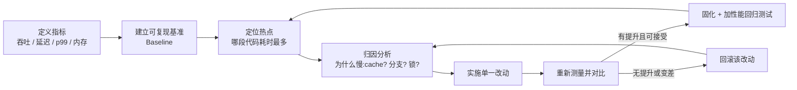

目标： 理解性能优化的方向、认识性能检查工具、构建性能优化的开发环境

# 一、 性能优化概论

性能优化不是"把代码写得更花哨"，而是一门**以测量为前提的工程活动**。本节先建立三个认知：性能问题的来源、发现问题的手段、解决问题的顺序。后面 29 天的所有工具与技巧，都是这三个问题的展开。

贯穿全课程的一条铁律：

> **不要猜，去测量（Don't guess, measure）。**
> 没有基准数据的优化，只是把一段代码换成另一段你更喜欢的代码。

## 1.1 性能问题从哪里来？

### 1.1.1 分层视角

同一份"慢"的表象，根因可能分布在完全不同的层次上。不同层次的优化收益差着数量级，因此**先判断层次，再选手段**。

| 层次 | 典型问题 | 典型收益量级 |
| --- | --- | --- |
| 需求 / 架构 | 做了本不必做的工作、重复计算、同步调用可异步化 | 10x ~ 100x |
| 算法与数据结构 | O(n²) 当 O(n log n) 用、容器选错（`list` 当 `vector` 用） | 10x ~ 1000x |
| 内存与缓存 | 访问模式不连续、cache line 浪费、频繁堆分配 | 2x ~ 10x |
| 语言抽象代价 | 隐式拷贝、临时对象、虚函数阻断内联、异常路径 | 1.2x ~ 3x |
| 编译器与指令 | 未开优化、无法向量化、分支预测失败 | 1.1x ~ 5x |
| 并发 | 锁竞争、伪共享、任务划分不均、线程创建开销 | 取决于核数，也可能为负 |
| 系统与 IO | 系统调用过多、磁盘/网络阻塞、页错误 | 视场景而定 |

### 1.1.2 硬件与直觉的偏差

绝大多数"看不懂的慢"，源于程序员按**指令条数**估算成本，而现代 CPU 的成本主要由**数据在哪里**决定。下面是一组数量级参考（现代 x86 服务器，具体数值随硬件浮动，**记数量级即可**）：

| 操作 | 大致耗时 | 折算 CPU 周期（3GHz） |
| --- | --- | --- |
| 一次简单算术指令 | ~0.3 ns | 1 |
| L1 cache 命中 | ~1 ns | ~4 |
| L2 cache 命中 | ~4 ns | ~12 |
| L3 cache 命中 | ~15-40 ns | ~50-120 |
| 主存（DRAM）访问 | ~80-100 ns | ~250-300 |
| 分支预测失败 | ~5-7 ns | ~15-20 |
| 无竞争 mutex 加解锁 | ~20 ns | ~60 |
| 小对象 `malloc`/`free` | ~20-50 ns | ~60-150 |
| 有竞争的锁 / 线程切换 | ~1-10 μs | 数千至数万 |
| NVMe SSD 随机读 | ~50-100 μs | 十万级 |
| 同机房网络往返 | ~0.5 ms | 百万级 |

关键结论：**一次 DRAM 访问的代价，相当于几百条算术指令**。所以"减少内存访问次数、提高访问局部性"往往比"减少几次乘法"重要得多。

一个经典例子——两段循环的指令数几乎相同，耗时可能差 5-10 倍：

```cpp
// 版本 A：按行遍历，内存连续访问，cache 友好
for (size_t i = 0; i < N; ++i)
    for (size_t j = 0; j < N; ++j)
        sum += m[i * N + j];

// 版本 B：按列遍历，每次跨 N * sizeof(T) 字节，几乎每次都 cache miss
for (size_t j = 0; j < N; ++j)
    for (size_t i = 0; i < N; ++i)
        sum += m[i * N + j];
```

### 1.1.3 C++ 特有的"隐形开销"

C++ 承诺"零成本抽象"，但前提是**用对了**。常见的隐形开销：

```cpp
// 1. 隐式拷贝：函数签名一个 & 的差别
void handle(std::string s);              // 每次调用可能一次堆分配 + 拷贝
void handle(const std::string& s);       // 无拷贝
void handle(std::string_view s);         // 无拷贝，且接受字面量/子串

// 2. 循环内的临时对象
for (const auto& item : items)
    if (item.name() == std::string("abc")) { }   // 每轮构造一个 std::string

// 3. 热点循环里的虚函数：阻断内联，且可能预测失败
for (auto* s : shapes) total += s->area();       // 无法内联，无法向量化

// 4. 容器与增长策略
std::vector<int> v;                              // 未 reserve：多次 realloc + 拷贝
v.reserve(n);                                    // 一次分配到位
```

### 1.1.4 阿姆达尔定律：优化的天花板

若某部分占总时间比例为 $p$，将其加速 $s$ 倍，则整体加速比为：

$$
\text{Speedup} = \frac{1}{(1-p) + \dfrac{p}{s}}
$$

代入几个数：一段占用 5% 时间的代码，即使优化到**零耗时**，整体也只快 5.3%；而占 80% 的热点提速 4 倍，整体就能快 2.5 倍。

这条定律给出两个直接的行动准则：

1. **先找占比最大的部分**，而不是先找最容易改的部分；
2. 若热点占比很低，正确的决定是**不优化**（保留可读性）。

## 1.2 如何检查出这些性能问题？

### 1.2.1 标准工作流

性能工作是一个**闭环**，任何一步缺失都会让结论不可信：



两个易被忽略的要点：

- **指标要先定义**。"变快"是模糊的：批处理系统关心吞吐（QPS、GB/s），在线服务关心尾延迟（p99/p999），嵌入式可能关心内存峰值。优化目标不同，手段甚至相互冲突（例如批量化提升吞吐但恶化延迟）。
- **一次只改一处**。同时改三处再测量，你无法知道哪一处有效，甚至可能一处 +20%、一处 -15% 互相掩盖。

### 1.2.2 工具矩阵

| 目的 | 工具 | 本课程对应 |
| --- | --- | --- |
| 微基准测试（函数/片段级） | Google Benchmark | Day 2 |
| 整体特征与硬件计数器 | `perf stat`、`toplev` | Day 3 |
| 热点函数定位与调用图 | `perf record` / `perf report`、火焰图 | Day 4 |
| 指令级归因（C++ ↔ 汇编） | `perf annotate`、Compiler Explorer | Day 5 |
| 内存分配与峰值 | `heaptrack`、`valgrind massif` | Day 6 |
| 多线程与缓存一致性 | `perf c2c`、`perf sched` | Day 20 |

选择原则：**从粗到细**。先用 `perf stat` 看整体是"算力受限"还是"内存受限"，再用 `perf record` 找到热点函数，最后才用 `perf annotate` 深入指令。反过来做，容易在无关代码上耗掉一整天。

### 1.2.3 从计数器到结论

`perf stat` 的输出不是数字堆，每一项都指向一类根因：

```bash
perf stat -e cycles,instructions,cache-misses,cache-references,branch-misses,branches ./app
```

| 指标 | 计算方式 | 解读 |
| --- | --- | --- |
| IPC | instructions / cycles | < 1 说明流水线经常停顿，值得深挖；> 2 通常已较健康 |
| cache miss 率 | cache-misses / cache-references | 偏高 → 数据布局、访问模式、工作集过大 |
| branch miss 率 | branch-misses / branches | > 5% → 数据相关分支，考虑无分支写法或排序数据 |
| stalled cycles | 各类 stall 事件 | 区分前端取指瓶颈与后端内存/执行瓶颈 |

进一步的系统方法是 **Top-Down 分析**：把每个流水线槽位归入四类——`Retiring`（有效工作）、`Bad Speculation`（分支预测失败）、`Frontend Bound`（取指/解码不足）、`Backend Bound`（执行单元或内存等待）。哪一类占比最大，就往那个方向查。这套方法在 Day 3 展开。

### 1.2.4 让测量结果可信

初学者的测量结果常常是错的，原因基本集中在这几条：

- **编译选项**：拿 `-O0` 的数据下结论毫无意义，性能测试必须在 `-O2`/`-O3` 且带调试符号（`-g`）下进行。
- **死代码消除**：结果未被使用时，整段计算会被编译器删掉，测出"0.1 ns"的假象。需要 `benchmark::DoNotOptimize` / `ClobberMemory`（Day 2）。
- **环境噪声**：CPU 频率调节与 Turbo、其他进程干扰、绑核缺失。建议固定性能模式、绑核（`taskset`）、多次重复取中位数并观察方差。
- **数据不真实**：全零数据、完全有序数据、过小的数据集（整个工作集塞进 L1），都会让结论无法迁移到线上。
- **预热缺失**：首次运行包含页错误、动态库解析、JIT/缓存冷启动，应丢弃前若干轮。

## 1.3 如何解决这些性能问题？

### 1.3.1 三条核心思路

几乎所有优化手段都可归为三类，且优先级从上到下递减：

1. **少做事（Do less work）**：删除冗余计算、缓存结果、提前退出、降低算法复杂度、批量化合并调用。这是收益最高、最不损害可读性的一类。
2. **做得更快（Do it faster）**：提高数据局部性、改善数据布局、让编译器能内联与向量化、消除难预测分支、并行化。
3. **别浪费（Stop wasting）**：避免不必要的拷贝与堆分配、避免过度同步、复用缓冲区与对象池。

### 1.3.2 优化顺序清单

按此顺序推进，越靠前的收益/代价比越高：

| 顺序 | 层面 | 典型动作 | 验证工具 |
| --- | --- | --- | --- |
| 1 | 需求 / 架构 | 去掉不必要的工作、改同步为异步、加缓存 | 端到端指标 |
| 2 | 算法与数据结构 | 换复杂度更低的算法、换合适容器 | Google Benchmark |
| 3 | 内存访问 | AoS→SoA、字段重排、连续存储、`reserve` | `perf stat` cache-misses |
| 4 | 分配与拷贝 | `string_view`、移动语义、对象池、Arena | `heaptrack` |
| 5 | 分支与指令 | 无分支写法、查表、`likely/unlikely`、SIMD | `perf annotate` |
| 6 | 编译器 | `-O3`、`-march=native`、LTO、PGO | 对比基准 |
| 7 | 并发 | 任务划分、减少共享、消除伪共享 | `perf c2c` |

注意第 7 项**排在最后**：把一个存在严重 cache miss 的串行程序直接多线程化，往往只是让多个核一起等内存，甚至因伪共享而变慢。**先优化单线程，再并行化。**

### 1.3.3 一个最小闭环示例

问题代码：统计满足条件的元素数量。

```cpp
// Before：值传递引发拷贝，循环内构造临时 string，数据相关分支难以预测
size_t count_matches(std::vector<Item> items, std::string prefix) {
    size_t n = 0;
    for (size_t i = 0; i < items.size(); ++i) {
        if (items[i].name().substr(0, prefix.size()) == prefix)  // 每轮一次堆分配
            ++n;
    }
    return n;
}
```

```cpp
// After：消除拷贝与临时对象，把判断改为无分配的前缀比较
size_t count_matches(const std::vector<Item>& items, std::string_view prefix) {
    size_t n = 0;
    for (const Item& it : items) {
        std::string_view name = it.name();
        n += (name.size() >= prefix.size() &&
              name.compare(0, prefix.size(), prefix) == 0);   // 累加代替分支
    }
    return n;
}
```

改动的**可验证预期**（这一步是重点，不能只写"应该更快"）：

- 基准耗时下降；
- `heaptrack` 中该函数的分配次数从 O(n) 降到 0；
- `perf stat` 的 `branch-misses` 下降（分支被替换为算术累加）。

若测量结果与预期不符，说明对根因的判断是错的，回到 1.2 重新归因，而不是继续叠加改动。

### 1.3.4 工程纪律

- **保留基准与数据**：每次优化记录环境、编译选项、前后数值，否则三天后无人能复现。
- **加性能回归测试**：优化成果会被后续需求悄悄改回去，需要 CI 中的基准守护（Day 27）。
- **评估维护成本**：一个 15% 的提升如果让代码难以理解和修改，通常不值得；关键路径上的 3x 提升则值得付出复杂度。
- **明确何时停止**：达到指标即停。追求"极致"是无底洞，工程上要用目标而非情绪收尾。

### 1.3.5 本节小结

| 问题 | 答案 |
| --- | --- |
| 性能问题从哪来 | 分布在架构、算法、内存、抽象、指令、并发、IO 七个层次；现代硬件下**内存访问**与**分支预测**是最常被低估的来源 |
| 如何发现 | 定义指标 → 建立可复现基准 → 定位热点 → 用硬件计数器归因 → 验证，工具从粗到细 |
| 如何解决 | 少做事 / 做得更快 / 别浪费；按"架构→算法→内存→分配→指令→编译器→并发"的顺序推进，一次只改一处 |


# 二、性能优化的环境构建

第 1 节的结论是"一切从测量开始"，那么第一天的动手任务就是把**可测量的环境**搭好。本节所有命令均在 `Ubuntu 24.04 LTS / GCC 13.3 / CMake 3.28 / Ninja 1.11 / AMD Zen4（8 核 16 线程）` 上实测通过；其他发行版思路一致，仅包管理器命令不同。

## 2.1 环境清单与验收标准

| 组件 | 作用 | 验收命令 | 期望结果 |
| --- | --- | --- | --- |
| GCC / Clang | 两套编译器交叉验证优化效果 | `g++ --version`、`clang++ --version` | 版本 ≥ GCC 11 / Clang 14 |
| CMake + Ninja | 统一构建、快速增量编译 | `cmake --version`、`ninja --version` | CMake ≥ 3.20 |
| Google Benchmark | 微基准测试 | `2.6` 节示例可运行 | 输出 ns/op 与统计量 |
| `perf` | 热点定位与硬件计数器 | `perf stat -e cycles,instructions true` | 能输出计数，非报错 |
| heaptrack / valgrind | 内存分配与峰值分析 | `heaptrack --version` | 有版本号（Day 6 使用） |
| Compiler Explorer | 观察生成的汇编 | 浏览器打开 godbolt.org | 能编译并显示汇编 |

**只要有一项验收失败，就不要开始 Day 2**，否则后续所有数据都不可信。

## 2.2 基础工具链

```bash
sudo apt update
sudo apt install -y build-essential g++ clang cmake ninja-build git \
                    linux-tools-common linux-tools-generic linux-tools-$(uname -r)
```

为什么要装**两套编译器**：同一段代码 GCC 与 Clang 的内联、向量化、循环变换决策常常不同。当你观察到一个"优化有效"的现象时，用另一套编译器复现一次，能区分"真实的算法/内存改善"与"恰好迎合了某个编译器的启发式规则"。Day 15-17 会大量用到这种对照。

需要注意 Ubuntu 的 `clang` 包可能只提供带版本号的可执行文件（如本机为 `clang-18`）。可显式指定编译器：

```bash
cmake -S . -B build-clang -G Ninja -DCMAKE_CXX_COMPILER=clang++-18
```

## 2.3 安装 perf 并打开权限（最容易卡住的一步）

`perf` 属于内核工具，**版本必须与运行内核匹配**。若执行 `perf` 时提示 `WARNING: perf not found for kernel x.y`，说明缺少对应内核的工具包，按提示安装 `linux-tools-$(uname -r)` 即可。

装好后往往还会遇到权限问题。本机的实测报错就是典型例子：

```
$ perf stat -e cycles,instructions true
No supported events found.
Access to performance monitoring and observability operations is limited.
perf_event_paranoid setting is 4
```

这不是硬件不支持，而是内核的 `perf_event_paranoid` 开关限制了非特权用户。各级别含义：

| 取值 | 含义 |
| --- | --- |
| `4`（部分发行版默认） | 非特权用户完全禁止使用 perf |
| `2` | 允许用户态采样，禁止内核态 profiling |
| `1` | 允许 CPU 事件与用户态采样（**日常开发推荐**） |
| `-1` | 几乎不限制（调试内核时使用） |

调整方式：

```bash
# 临时生效（重启后失效）
sudo sysctl -w kernel.perf_event_paranoid=1
sudo sysctl -w kernel.kptr_restrict=0        # 让 perf 能解析内核符号

# 永久生效
sudo tee /etc/sysctl.d/99-perf.conf <<'EOF'
kernel.perf_event_paranoid = 1
kernel.kptr_restrict = 0
EOF
sudo sysctl --system

# 再次验证
perf stat -e cycles,instructions,cache-misses true
```

> **安全提示**：降低 `perf_event_paranoid` 会让本机所有用户都能采样其他进程，属于开发机上的合理取舍，**不要在生产/共享服务器上随意放开**；那类环境应通过 `CAP_PERFMON` 精确授权给指定用户。

另有两类环境从根上拿不到硬件计数器，需要提前识别，避免把时间浪费在调参上：

- **虚拟机 / WSL2 / 部分云主机**：hypervisor 未透传 PMU，`perf stat` 只能给出 `task-clock` 等软件事件，`cycles`、`cache-misses` 全为 `<not supported>`。用 `lscpu | grep -i hypervisor` 判断。
- **容器**：默认 seccomp 策略屏蔽 `perf_event_open`，需要 `docker run --cap-add=CAP_PERFMON --security-opt seccomp=unconfined`。

若确实无法获得 PMU，Day 3-5 的计数器实验请在物理机上完成，或退化为 `valgrind --tool=callgrind` 这类模拟式分析（结果是指令数而非真实周期，只能看相对趋势）。

另一个平台差异要早知道：**Top-Down 分析的 `toplev`（pmu-tools）只支持 Intel**。AMD 平台（如本机 Zen4）应改用 `perf list` 查看可用事件、`perf stat -M <metric>` 取现成指标，或使用 AMD uProf；`perf record` / `annotate` / `c2c` 在两个平台都可用。

## 2.4 Google Benchmark

两种安装方式，各有适用场景：

```bash
# 方式一：系统包，装起来最快（本机为 1.8.3）
sudo apt install -y libbenchmark-dev
```

```cmake
# 方式二：源码固定版本，保证团队/CI 结果可比
include(FetchContent)
set(BENCHMARK_ENABLE_TESTING OFF)
set(BENCHMARK_ENABLE_GTEST_TESTS OFF)
FetchContent_Declare(benchmark
    GIT_REPOSITORY https://github.com/google/benchmark.git
    GIT_TAG        v1.9.1)
FetchContent_MakeAvailable(benchmark)
```

课程约定：**自己电脑上用方式一，写进仓库的骨架用"先 find_package、找不到再 FetchContent"的兜底写法**（见 2.6），这样别人 clone 后无需额外安装也能构建。注意基准库自身务必以 Release 语义编译，否则测量的是库的调试开销。

## 2.5 内存与可视化工具

```bash
sudo apt install -y heaptrack heaptrack-gui valgrind hotspot
```

| 工具 | 解决什么问题 | 使用时机 |
| --- | --- | --- |
| `heaptrack` | 分配次数、分配来源、峰值、泄漏 | Day 6、Day 12 |
| `valgrind massif` | 内存占用随时间变化曲线 | Day 6 |
| `hotspot` | `perf.data` 的图形化火焰图 | Day 4 |
| FlameGraph 脚本 | 无 GUI 环境下生成 SVG 火焰图 | Day 4 |

```bash
# 无桌面环境时用脚本版火焰图
git clone https://github.com/brendangregg/FlameGraph ~/tools/FlameGraph
```

汇编观察推荐直接用在线 [Compiler Explorer](https://godbolt.org)：能并排对比不同编译器/优化级别的输出。需要看**本机真实构建产物**的汇编时，用 `objdump -dS ./build/bench_traverse` 或 `perf annotate`，因为在线环境的编译选项和你的工程未必一致。

## 2.6 可复用的工程骨架

后续每天的实验都用同一套骨架，避免重复搭建。目录结构：

```
dayN/
├── CMakeLists.txt
├── bench/            # 微基准
├── src/              # 被测代码
└── scripts/          # 环境与测量脚本
```

`CMakeLists.txt`：

```cmake
cmake_minimum_required(VERSION 3.20)
project(perf30days CXX)

set(CMAKE_CXX_STANDARD 20)
set(CMAKE_CXX_STANDARD_REQUIRED ON)
set(CMAKE_EXPORT_COMPILE_COMMANDS ON)   # 供 clangd / 工具链使用

# 默认 RelWithDebInfo：等价于 -O2 -g，既是优化构建又保留调试符号
if(NOT CMAKE_BUILD_TYPE AND NOT CMAKE_CONFIGURATION_TYPES)
    set(CMAKE_BUILD_TYPE RelWithDebInfo CACHE STRING "" FORCE)
endif()

# 保留栈帧指针，否则 perf 采样拿不到完整调用栈
add_compile_options(-Wall -Wextra -fno-omit-frame-pointer)

find_package(benchmark QUIET)
if(NOT benchmark_FOUND)
    include(FetchContent)
    set(BENCHMARK_ENABLE_TESTING OFF)
    set(BENCHMARK_ENABLE_GTEST_TESTS OFF)
    FetchContent_Declare(benchmark
        GIT_REPOSITORY https://github.com/google/benchmark.git
        GIT_TAG        v1.9.1)
    FetchContent_MakeAvailable(benchmark)
endif()

add_executable(bench_traverse bench/bench_traverse.cpp)
target_link_libraries(bench_traverse PRIVATE benchmark::benchmark)
```

三个选项的理由，务必理解而非照抄：

- **`RelWithDebInfo`（`-O2 -g`）**：性能数据必须来自优化构建，同时需要符号才能定位到函数与源码行。用 `Debug` 测出的结论几乎全部无效。
- **`-fno-omit-frame-pointer`**：`-O2` 下编译器会复用 `rbp` 寄存器，导致 `perf record -g` 的调用栈断裂。代价是极小的性能损失（通常 < 1%），换来可用的火焰图。若不想加该选项，可改用 `perf record --call-graph dwarf`（开销更大，但不改变被测代码）。
- **`CMAKE_EXPORT_COMPILE_COMMANDS`**：生成 `compile_commands.json`，让编辑器与静态分析工具看到与构建完全一致的选项。

`bench/bench_traverse.cpp`——用第 1.1.2 节的行/列遍历作为环境自检用例：

```cpp
#include <benchmark/benchmark.h>

#include <cstddef>
#include <cstdint>
#include <vector>

namespace {
constexpr std::size_t kN = 1024;

void BM_RowMajor(benchmark::State& state) {
  std::vector<float> m(kN * kN, 1.0f);
  for (auto _ : state) {
    float sum = 0.0f;
    for (std::size_t i = 0; i < kN; ++i)
      for (std::size_t j = 0; j < kN; ++j) sum += m[i * kN + j];
    benchmark::DoNotOptimize(sum);   // 关键：否则整个循环会被优化掉
  }
  state.SetBytesProcessed(std::int64_t(state.iterations()) * kN * kN * sizeof(float));
}
BENCHMARK(BM_RowMajor);

void BM_ColumnMajor(benchmark::State& state) {
  std::vector<float> m(kN * kN, 1.0f);
  for (auto _ : state) {
    float sum = 0.0f;
    for (std::size_t j = 0; j < kN; ++j)
      for (std::size_t i = 0; i < kN; ++i) sum += m[i * kN + j];
    benchmark::DoNotOptimize(sum);
  }
  state.SetBytesProcessed(std::int64_t(state.iterations()) * kN * kN * sizeof(float));
}
BENCHMARK(BM_ColumnMajor);
}  // namespace

BENCHMARK_MAIN();
```

构建与运行：

```bash
cmake -S . -B build -G Ninja
cmake --build build
taskset -c 2 ./build/bench_traverse \
        --benchmark_repetitions=3 --benchmark_report_aggregates_only=true
```

## 2.7 让测量稳定：机器状态调优

同一个二进制，机器状态不同可以差出百分之几十。开始测量前先固定环境：

```bash
# 1. 频率固定为性能模式（最重要）
sudo cpupower frequency-set -g performance
cat /sys/devices/system/cpu/cpu0/cpufreq/scaling_governor   # 期望 performance

# 2. 关闭睿频，消除温度导致的漂移
echo 0 | sudo tee /sys/devices/system/cpu/cpufreq/boost              # AMD
echo 1 | sudo tee /sys/devices/system/cpu/intel_pstate/no_turbo      # Intel

# 3. 绑核运行，避免调度迁移与 SMT 干扰（下例绑到物理核 2）
taskset -c 2 ./build/bench_traverse

# 4. 检查后台负载，Load Average 应接近空闲
uptime
```

几条经验：

- **笔记本必须插电**，电池模式下的功耗墙会让数据毫无规律。
- Google Benchmark 若打印 `CPU scaling is enabled` 警告，说明第 1 步没生效，此时的数据不要采信。
- 关注**变异系数 `cv`**（重复测量的相对标准差）：`cv < 2%` 可以判断 5% 的改进；若 `cv` 有 10%，那么"提升 8%"很可能只是噪声。
- 结论要基于**中位数**而非单次或均值，均值容易被个别抖动拉偏。

## 2.8 环境验收：跑通这三件事

**① 基准测试能跑出稳定数据。**本机实测（`kN=1024`，约 4 MB 数据，超出 L2、接近 L3）：

```
BM_RowMajor_median        671060 ns    bytes_per_second=5.82Gi/s   cv=0.38%
BM_ColumnMajor_median    6135120 ns    bytes_per_second=652Mi/s    cv=0.09%
```

两者指令数几乎相同，耗时差 **9.1 倍**——这正是第 1.1.2 节结论的现场复现。`cv` 均小于 0.5%，说明环境足够干净。

**② `perf stat` 能拿到硬件计数器，并解释上面的差异。**

```bash
perf stat -e cycles,instructions,cache-misses,cache-references,branch-misses \
     taskset -c 2 ./build/bench_traverse --benchmark_filter=ColumnMajor
```

预期观察：列遍历版本的 `cache-misses / cache-references` 显著高于行遍历版本，而 IPC 明显更低。**能亲手看到这两个数字的差异，才算真正打通了工具链。**

**③ 能从热点函数下钻到汇编。**

```bash
perf record -g ./build/bench_traverse --benchmark_filter=RowMajor
perf report --stdio          # 热点函数占比
perf annotate -M intel       # 逐条指令的开销
```

## 2.9 记录你的基线环境

性能数据离开环境就没有意义。在每个 `dayN/` 目录下建立 `ENV.md`，第一天填好后长期沿用：

| 项目 | 本机示例 |
| --- | --- |
| CPU | AMD Ryzen 7 7840HS，8 核 16 线程 |
| 缓存 | L1d 32KiB×8，L2 1MiB×8，L3 16MiB |
| 内存 | 32 GB DDR5（`free -g` 可用 27 GB，APU 共享显存） |
| 系统 / 内核 | Ubuntu 24.04.3 LTS，7.0.0-28-generic |
| 编译器 | GCC 13.3.0 / Clang 18 |
| 构建配置 | CMake 3.28.3 + Ninja，RelWithDebInfo |
| 频率策略 | governor=performance，boost 关闭 |
| 基准库 | Google Benchmark 1.8.3 |

其中**缓存容量**要专门记下来（`lscpu` 可查）：后续设计实验时，数据集是否超出 L1/L2/L3 直接决定你能观察到什么现象。

## 2.10 常见问题排查表

| 现象 | 原因 | 处理 |
| --- | --- | --- |
| `perf: No supported events found` | `perf_event_paranoid` 过高 | 见 2.3，设为 1 |
| `WARNING: perf not found for kernel` | perf 与内核版本不匹配 | 安装 `linux-tools-$(uname -r)` |
| `cycles` 显示 `<not supported>` | 虚拟机/容器无 PMU | 换物理机，或改用 callgrind |
| 基准结果为 0 ns 或快得离谱 | 计算被编译器消除 | 加 `benchmark::DoNotOptimize` |
| `perf report` 只有地址没有函数名 | 无调试符号 / 被 strip | 用 `RelWithDebInfo` 构建 |
| 调用栈只有一层 | `-O2` 省略了栈帧指针 | 加 `-fno-omit-frame-pointer` 或 `--call-graph dwarf` |
| 每次跑数据差很多 | 频率漂移、后台负载、未绑核 | 见 2.7，并看 `cv` |
| 基准打印 CPU scaling 警告 | governor 不是 performance | `cpupower frequency-set -g performance` |

## 2.11 Day 1 作业

1. 按 2.1 的清单完成安装，并让**三项验收**全部通过。
2. 填写自己的 `ENV.md`。
3. 运行 `bench_traverse`，记录行/列遍历的耗时比，并用 `perf stat` 采集两者的 cache miss 率，写下你的解释。
4. 思考题：把 `kN` 从 1024 逐步降到 64，两个版本的差距会如何变化？先写下预测，再实测验证——这是 Day 8 缓存层次的预热。

