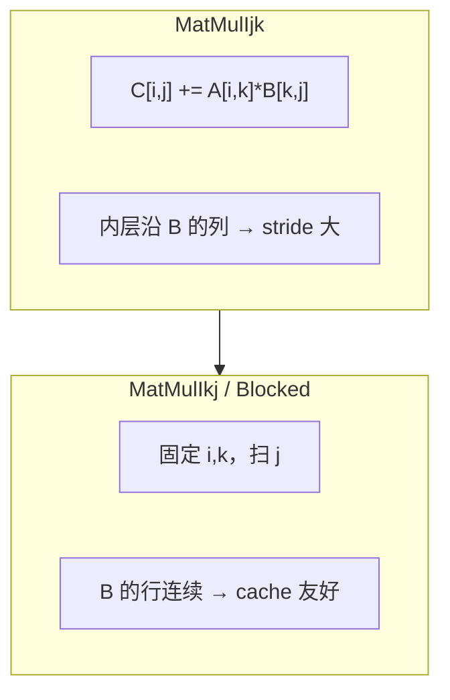

# Day10: 循环优化 — 交换、分块、展开

目标：

- **循环交换**改善内层访问连续性（`ijk` → `ikj`）。
- **分块（tiling）** 让工作集适配 L1/L2。
- 区分手动展开与编译器 `-O3` 自动展开/向量化。

预期学习时间：4h

---

# 一、矩阵乘数据流



---

# 二、运行

```bash
cd day10
cmake -S . -B build -G Ninja && cmake --build build
./build/bench_matmul --benchmark_repetitions=3
```

对 `BM_Ijk` 与 `BM_Ikj` 跑 Day3 的 `perf stat`，对比 cache-misses。

---

# 三、Day 10 作业

1. 填写 Ijk / Ikj / Blocked32 / Unroll4 的 median 时间比。
2. 尝试 block size 16/32/64（改 `BM_Blocked32` 或新增 benchmark），记录最优块大小与 L1 大小的关系。
3. 在 Compiler Explorer 上对比 `MatMulIkj` 在 `-O2` vs `-O3 -march=native` 是否自动向量化；手动 Unroll4 是否仍必要？
