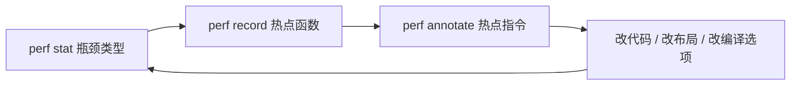

# Day5: `perf annotate` — 从 C++ 到汇编

目标：

- 在热点函数内看到 **源码行 / 汇编 / 采样占比** 的对应关系。
- 会用 **objdump** 与 **Compiler Explorer** 交叉验证编译器生成的指令。
- 理解向量化、内存访问指令与 cache miss 在 annotate 里的「样子」。

预期学习时间：3–4h

---

# 一、annotate 在流程中的位置



---

# 二、动手

```bash
cd day5
chmod +x scripts/run_perf_annotate.sh
./scripts/run_perf_annotate.sh col 1024 16
ANNOTATE_SYMBOL=SumRowMajor ./scripts/run_perf_annotate.sh row 1024 8
```

本机汇编（与 perf 使用同一二进制）：

```bash
cmake -S . -B build && cmake --build build
objdump -dS build/workload_demo > /tmp/workload_demo.asm
```

---

# 三、读 annotate 的要点

1. **热点行**是否落在内层循环的 load/add 上？列主序常看到 load 等待（Backend Bound）。
2. 对比 **`-O2` 与 `-O3 -march=native`**（单独建 build-Release）循环是否被向量化（xmm/ymm 寄存器、`vaddps` 等）。
3. **branchy** 模式：`CountBranchy` 内 `cmp` + `jcc` 是否占比较高？

## 3.1 Compiler Explorer 建议

将 `SumRowMajor` / `SumColMajor` 内层循环贴到 [godbolt.org](https://godbolt.org)，编译选项与 CMake 保持一致（`-O2 -g -fno-omit-frame-pointer`），对比 GCC vs Clang。

---

# 四、Day 5 作业

1. 截一段 `perf annotate` 输出，标出 **采样占比最高** 的一条汇编指令。
2. 说明列主序相对行主序，annotate 中 **load 指令** 比例或 stall 有何不同（结合 Day 3 的 cache-misses）。
3. 用 objdump 或 CE 确认：编译器是否对 `SumRowMajor` 做了 **自动向量化**？若没有，试加 `-O3 -march=native` 后是否出现 SIMD？
4. 思考题：为什么 annotate 的百分比之和不一定等于 100%？（采样、内联、共享库）
